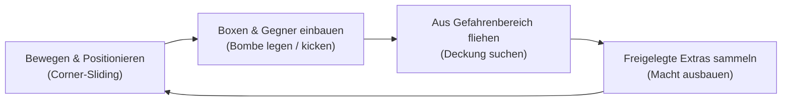
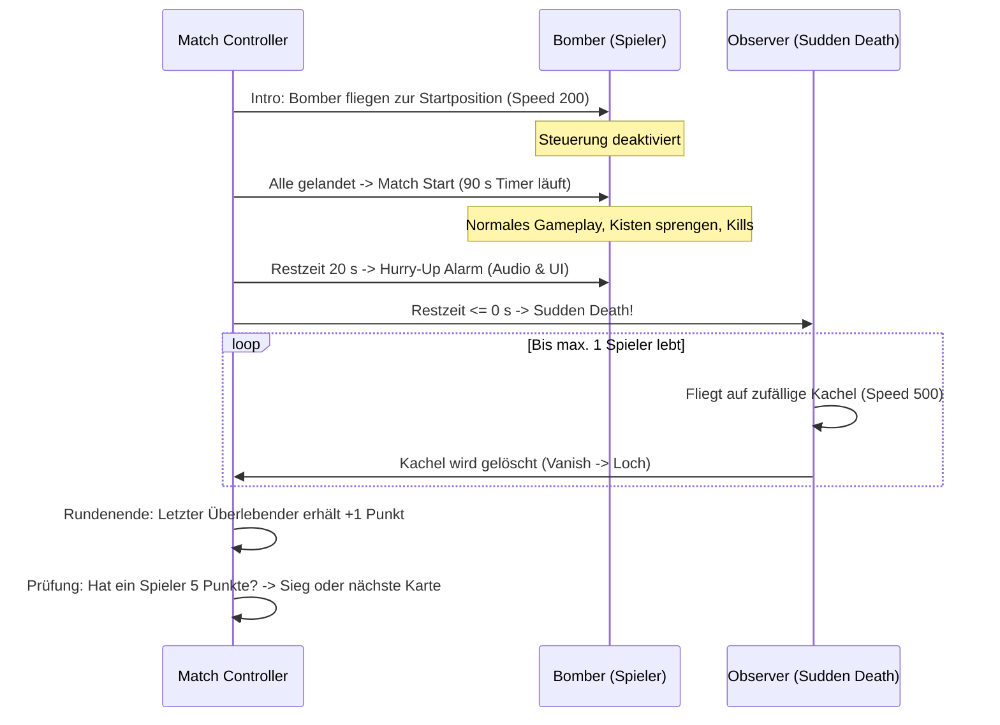
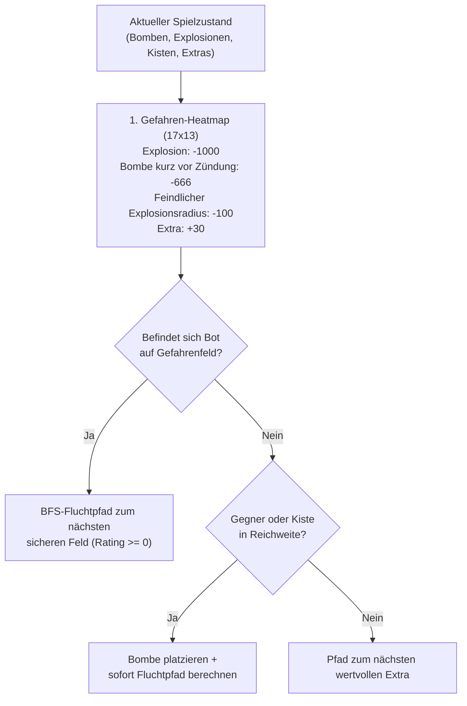

# Game Design Document: ClanBomber (Godot Edition)

> **Modulare Version:** Dieses Dokument ist für KI-Agenten-Workflows und Phasen-Sprints modular in **[docs/gdd/](docs/gdd/INDEX.md)** aufgeteilt (`01_concept_and_loop.md` bis `05_parameters.md`).

**Projekt:** ClanBomber Godot  
**Ziel-Engine:** Godot Engine 4.x (Forward+, 2.5D)  
**Genre:** 2.5D Top-Down Arcade Multiplayer Action (2D-Simulationslogik, 3D-Präsentation)  
**Zielplattform:** Desktop (macOS, Linux, Windows)  
**Vorlage:** *ClanBomber* (GPL, historisches C++-Original von 1998–2002)  
**Status:** Normatives Gesamtdokument (v1.1, 2.5D-Update)  

---

## 1. Executive Summary & High Concept

### 1.1 High Concept
*ClanBomber: Godot Edition* ist ein rasantes 2.5D-Top-Down-Partyspiel für bis zu 8 lokale menschliche und/oder KI-gesteuerte Spieler. Auf einem festen 17×13 Kachelraster platzieren die Spieler Bomben, sprengen Blöcke frei, sammeln Power-Ups und versuchen, alle Rivalen von der Bildfläche zu tilgen, bevor der berüchtigte „Observer“ im Sudden Death das Spielfeld vernichtet. Das Spiel kombiniert die mathematisch exakte 2D-Simulationslogik des Originals mit moderner 2.5D-Präsentation (Forward+ Renderer, $70^\circ$ Top-Down-Kamera, dynamisches Licht für brennende Lunten und physikalisch zersplitternde 3D-Kisten).

### 1.2 Säulen des Gameplays
1. **Snappy & Präzise:** Flüssige, kontinuierliche Bewegung mit dynamischem **Corner-Sliding** (automatisches Hineingleiten in Gassen an Wandecken).
2. **Kettenreaktionen & Taktik:** Strategisches Legen, Kicken und Werfen von Bomben mit millimetergenau getakteten Kettenexplosionen.
3. **Chaotischer Party-Multiplayer:** Bis zu 8 Spieler an einem Bildschirm (Gamepads, geteilte Tastaturen, schlaue KI-Bots).
4. **Vollständige Retro-Kompatibilität:** 100 % originalgetreue Unterstützung aller 33 kanonischen ClanBomber-Karten.

---

## 2. Core Loop & Gameplay-Mechaniken

### 2.1 Der 10-Sekunden-Core-Loop


### 2.2 Spielfeld & Raster
- **Grid-Dimensionen:** Festes Raster von **17 Spalten $\times$ 13 Zeilen** ($221$ Kacheln).
- **Zellengröße:** Logisch $40 \times 40$ Pixel (in Godot als Vektor-/Pixel-Canvas dynamisch auf 1080p/4K skalierbar).
- **Zellkoordinaten & Zuordnung:**
  - Die Bewegung der Figuren ist **kontinuierlich (Float)** im 2D-Raum.
  - Die Zuordnung zu einer Zelle erfolgt deterministisch über Rundung zur Zellmitte:
    $$\text{cell}_X = \lfloor (x + 20) / 40 \rfloor, \quad \text{cell}_Y = \lfloor (y + 20) / 40 \rfloor$$

### 2.3 Bewegung & Corner-Sliding
- **Basis-Geschwindigkeit:** $90\,\text{px/s}$ (steigert sich um $+40\,\text{px/s}$ pro gesammeltem Skateboard bis max. $290\,\text{px/s}$).
- **Delta-Time-Integration (1-Pixel-Sub-Stepping):** Pro Simulationsschritt $dt$ wird die Strecke $\Delta s = \text{speed} \cdot dt + \text{remainder}$ in diskrete 1-Pixel-Schritte (`span = int(step)`) aufgelöst. Der Bruchrest bleibt im Akkumulator (`remainder`).
- **Corner-Sliding (Deterministisches Kantengleiten):**
  - Läuft ein Spieler z. B. nach rechts und die vordere Kachel ist frei, aber oben/unten blockiert eine Kante, prüfen diagonale Abtastpunkte (`y % 40 > 19` vs. `y % 40 <= 19`), ob eine benachbarte freie Gasse existiert.
  - Befindet sich der Spieler zu mehr als $50\,\%$ in der Fluchtlinie, wird er pro Sub-Step um $1\,\text{px}$ orthogonal abgelenkt ($y \leftarrow y \pm 1$).
  - Verhindert das Hängenbleiben an Ecken und sorgt für das butterweiche Original-Spielgefühl.
- **Durchlässigkeit eigener Bomben:**
  - Eine frisch gelegte Bombe blockiert den Spieler *nicht sofort*, solange er sich noch zu $\ge 50\,\%$ auf der Quellzelle befindet (`x % 40 > 19` bzw. `y % 40 > 19`), damit er das Feld verlassen kann.

---

## 3. Bomben & Explosions-Physik

### 3.1 Die Bombe
- **Zünder (Countdown):** Standardmäßig **$2{,}5\,\text{s}$** (`bomb_countdown = 25` Zehntelsekunden).
- **Kapazität:** Jeder Spieler startet mit 1 Bombe (erweiterbar bis max. 9). Nach Detonation wird die Kapazität sofort wieder frei.
- **Kettenreaktion:** Wird eine ruhende oder rollende Bombe von einem Explosionsstrahl erfasst, zündet sie nicht instantan, sondern erhält einen minimalen Rest-Timer von maximal **$0{,}1\,\text{s}$** (`bomb_delay = 10`). Dies erzeugt visuell getaktete Kettenkaskaden.
- **Kicken:** Besitzt der Spieler das Kick-Extra und läuft gegen eine ruhende Bombe, rollt diese mit **$160\,\text{px/s}$** ($4$ Zellen/s) in gerader Linie, bis sie auf ein Hindernis (Wand, Box, Bombe) trifft und auf der Zellmitte einrastet.
- **Werfen (Glove):** Steht der Spieler unbewegt auf einer Bombe und besitzt das Glove-Extra, wirft der Bomben-Button die Bombe exakt **4 Zellen** weit (`fields = 4`). Fliegende Bomben können **nicht über feste Wände** fliegen (`can_fly_over_walls = false`).
- **Löcher:** Fällt eine Bombe in ein Loch (Sudden Death / Vanish), verschwindet sie spurlos ohne Detonation.

### 3.2 Die Explosion
- **Form:** Vierarmiges orthogonales Kreuz (Nord, Ost, Süd, West) ausgehend von der Bombenmitte.
- **Reichweite:** Standardmäßig $1$ Zelle pro Richtung (steigert sich pro Power-Extra um $+1$ bis max. 12).
- **Ausbreitungsregeln (Strikt deterministisch):**
  - Die Strahllänge wird **beim Zündungszeitpunkt** berechnet.
  - Der Strahl stoppt **vor** blockierenden Wänden (`Wall`), Kisten (`Box`) und vor Feldern mit **Extras**.
  - Nur das erste blockierende Element am Ende des Strahls wird zerstört (`destroy()` auf Kiste oder Extra).
  - Wandkacheln (`Wall`) sind unzerstörbar.
- **Detonationsdauer & Tödlichkeit:**
  - Die Explosion bleibt für genau **$0{,}5\,\text{s}$** aktiv.
  - Jeder Bomber, der sich zu einem beliebigen Zeitpunkt während dieser $0{,}5\,\text{s}$ in einer Strahlzelle aufhält, stirbt sofort (`die()`).
  - Ein Kill wird dem Verursacher der Bombe nur gutgeschrieben, wenn Opfer $\ne$ Verursacher (Selbstmord gibt keinen Punkt).

---

## 4. Kacheln (Map Tiles)

| Kachel | Symbol | Verhalten |
|---|:---:|---|
| **Ground** | ` ` | Normal begehbar, nimmt Bomben und Extras auf. |
| **Wall** | `*` | Blockiert Spieler und Bomben vollständig. Unzerstörbar. |
| **Box** | `+` | Blockiert. Wird von Explosion zerstört (0,5 s Animation). Droppt mit $\approx 52\,\%$ Chance ein Extra. |
| **Random** | `R` | Kartengenerator ersetzt dies zu $2/3$ durch Boxen und zu $1/3$ durch Ground. |
| **Ice** | `S` | Begehbar. Reibungsfrei: Schiebt jedes Objekt mit $80\,\text{px/s}$ in seiner aktuellen Bewegungsrichtung weiter (Rutschen). Bleibt permanent bestehen. |
| **Arrow** | `< > ^ v` | Schiebt rollende oder landende Bomben sofort in Pfeilrichtung weiter. Bei Gegenverkehr: 0,5 s Stopp ("Chill"), dann Richtungsumkehr. |
| **Trap** | `o` | Fällt eine Bombe auf eine Falle, wird sie für $1{,}0\,\text{s}$ aus dem Spiel genommen und dann mit Speed 200 auf ein zufälliges freies Feld katapultiert. Der Zünder wird auf $0{,}01\,\text{s}$ gesetzt $\implies$ detoniert sofort bei Aufschlag! |
| **Hole (Vanish)**| `-` | Durch Sudden Death entstandenes Bodenloch. Jeder Bomber, der hineintritt, stürzt in die Tiefe und scheidet aus. Bomben werden gelöscht. |

---

## 5. Extras, Handicaps & Drop-Raten

### 5.1 Positive Extras (Power-Ups)
Wird durch Betreten aufgenommen. **Jede Aufnahme eines regulären Extras heilt eine aktive Disease!**

| Extra | Effekt | Maximum |
|---|---|:---:|
| **Bomb** | $+1$ Bombenkapazität | 9 |
| **Power** | $+1$ Explosionsreichweite | 12 |
| **Skateboard** | $+40\,\text{px/s}$ Laufgeschwindigkeit | 5 ($290\,\text{px/s}$) |
| **Kick** | Erlaubt das Treten ruhender Bomben | 1 |
| **Glove** | Erlaubt das Aufheben und Werfen von Bomben | 1 |

### 5.2 Negative Handicaps (Bereinigte Nomenklatur)
*Hinweis zur Spielkultur:* Die Original-Drogen-/Sexualthematik des C++-Urahns (Joint, Koks, Viagra) wird durch zeitgemäße, jugendfreie Arcade-Begriffe ersetzt:

| Interner Code | Neuer Name | Dauer | Effekt |
|---|---|:---:|---|
| *Fast* | **Overdrive** | $10\,\text{s}$ | Extreme Geschwindigkeit ($+600\,\text{px/s}$), kaum steuerbar. |
| *Stoned* | **Reverse** | $10\,\text{s}$ | Steuerungsachsen sind komplett invertiert. |
| *PutBomb* | **Autobomb** | $10\,\text{s}$ | Legt unkontrolliert automatisch Bomben, sobald Kapazität frei ist. |

*Freeze* wird bewusst nicht übernommen: Im Original ist es reiner Totcode und wird nie erzeugt.

- **Ansteckung:** Läuft ein infizierter Spieler gegen einen Mitspieler, überträgt sich das Handicap sofort (`infect_others`).

### 5.3 Drop-Verteilung aus zerstörten Boxen
Bei Zerstörung einer Kiste wird deterministisch gewürfelt (`rand % 8`):
- `0`: Power ($12{,}5\,\%$)
- `1`: Bomb ($12{,}5\,\%$)
- `2`: Skateboard ($12{,}5\,\%$)
- `3`: $50\,\%$ Kick / $50\,\%$ Glove ($6{,}25\,\%$ kumuliert, nur falls nicht Startausrüstung)
- `4`: Handicap / Disease ($6{,}25\,\%$, verteilt auf Overdrive, Reverse, Autobomb)
- `5` bis `7`: **Leer** ($37{,}5\,\%$)
$\implies$ Gesamt-Droprate pro Kiste: **ca. $52\,\%$**.

---

## 6. Match-Ablauf & Runden-Struktur



- **Siegbedingung:** Standardmäßig **5 Punkte** (`points_to_win = 5`).
- **Punktevergabe:** Sobald $\le 1$ Spieler am Leben ist und alle Explosionen sowie fliegenden Objekte beendet sind, erhält jeder lebende Spieler $+1$ Punkt (bei Unentschieden beide).

---

## 7. Level-System & Kartenformat

### 7.1 Textdatei-Spezifikation (`*.map`)
Das Spiel liest die 33 Originalkarten direkt über einen Godot-Text-Importer ein:
- **Zeile 1:** Autorenname (z. B. `Andreas Hundt`)
- **Zeile 2:** Maximale Spielerzahl (z. B. `8`)
- **Zeilen 3–15:** Genau 13 Zeilen mit jeweils 17 Zeichen (`*`, `+`, ` `, `R`, `S`, `<`, `>`, `^`, `v`, `o`, `0`–`7`).

### 7.2 Startpositionen
- Ziffern `0` bis `7` markieren feste Startfelder.
- Bei Rundenstart können Startpositionen je nach Config zufällig unter den aktiven Spielern verteilt werden (`random_positions = true`).

---

## 8. Steuerung & Lokaler Multiplayer

### 8.1 InputMap-Konfiguration in Godot
Volle Unterstützung für **bis zu 8 lokale Spieler**:
- **Player 1 & 2 (Tastatur):**
  - P1: `WASD` + `Leertaste` (Bombe) + `E` (Spezial / Throw)
  - P2: `Pfeiltasten` + `Rechte Strg / Enter` + `Rechtes Shift`
- **Player 1 bis 8 (Gamepads):**
  - Automatisches Binding via Godot Device-ID (`joy_connection_changed`):
  - D-Pad / Linker Analogstick für Bewegung
  - `A / Cross` (Unten): Bombe legen
  - `B / Circle` (Rechts): Bombe werfen / stoppen

---

## 9. KI-Architektur (Bot Controller)

KI-Gegner verwenden eine deterministische **Gefahren-Heatmap** gekoppelt mit **Breadth-First-Search (BFS)**:



- **Kein Selbstmord:** Der Bot platziert eine Bombe *nur dann*, wenn vor dem Legen bereits ein erreichbarer Fluchtweg mit Rating $\ge 0$ existiert.

---

## 10. Technische Architektur in Godot 4

### 10.1 Strikte Trennung: Simulation vs. Präsentation
```text
clanbomber-godot/
├── core/                       # 100 % reine GDScript-Logik (Engine-agnostisch)
│   ├── sim_game.gd             # Runden-Simulation, Timer, Punkte
│   ├── sim_board.gd            # 17x13 Grid-Zustand, Kacheln, Collision
│   ├── sim_bomb.gd             # Zünder, Reichweite, Kettenreaktion
│   ├── sim_ai.gd               # Gefahren-Heatmap & BFS-Pfadsuche
│   └── sim_types.gd            # Datenstrukturen, Enums, Konstanten
├── scene/                      # Dünne Godot-Node-Schicht (Rendering & Audio)
│   ├── main.tscn               # Haupt-Szene & UI-Manager
│   ├── board_view.tscn         # TileMapLayer für 17x13 Kacheln
│   ├── bomber_view.tscn        # CharacterBody2D / AnimatedSprite2D
│   ├── bomb_view.tscn          # Sprite2D mit Zünder-Animation
│   └── explosion_view.tscn     # Partikel / Animations-Kreuz
├── resources/                  # Godot Custom Resources
│   ├── map_data.gd             # Strukturierte Kartendaten
│   └── game_config.tres        # Zentrale Tuning-Parameter
└── test/                       # Automatisierte Headless-Tests (GUT / CLI)
    ├── test_simulation.gd      # Bomben-Timer, Kettenreaktion, Kills
    └── test_map_importer.gd    # Validierung aller 33 Original-Maps
```

### 10.2 Headless-Testbarkeit
- Die gesamte Spiellogik in `core/` erbt von `RefCounted` (nicht von `Node`).
- Kann in `< 50 ms` über `godot --headless -s test/run_tests.gd` im Terminal oder CI/CD getestet werden.

---

## 11. Phasen-Roadmap (MVP bis Polish)

### Phase 1: Der spielbare Kern (MVP)
- [ ] 17×13 Spielfeld mit Ground, Wall und Boxen
- [ ] 2 Bomber (WASD & Pfeiltasten) mit kontinuierlicher Bewegung & Corner-Sliding
- [ ] Bomben legen, $2{,}5\,\text{s}$ Zünder, $0{,}1\,\text{s}$ Kettenreaktion, Explosionen
- [ ] Kisten zerstören und Spieler-Eliminierung

### Phase 2: Power-Ups, Spezial-Tiles & Sudden Death
- [ ] Extra-Drop-System (Bomb, Power, Skateboard, Kick, Glove)
- [ ] Spezialkacheln: Ice (Rutschen), Arrow (Umlenker), Trap (Katapult)
- [ ] Handicaps: Overdrive, Reverse, Autobomb
- [ ] Der Sudden-Death-Observer zerstört das Feld nach 90 Sekunden

### Phase 3: Content, Karten & Runden-Management
- [ ] Map-Parser lädt alle 33 Original-`.map`-Dateien
- [ ] Bis zu 8 Spieler (Gamepad-Autodetect + Tastatur)
- [ ] Scoreboard, Siegpunkte (Best of 5), Kartenauswahl

### Phase 4: KI-Bots, Audio & Visual Polish (Juice)
- [ ] Autonome Bot-KI mit Gefahren-Heatmap und BFS
- [ ] Screen-Shake bei Explosionen, Partikel beim Zerplatzen von Kisten
- [ ] Einbindung aller 27 Original-Soundeffekte (`.wav`) und Retro-Soundtrack
- [ ] Headless CI/CD-Pipeline zur Regression-Absicherung

---

## 12. Anhang: Lizenz & Clean-Room-Hinweise

1. **Code-Lizenz:** Der C++-Urcode (`clanbomber` / `ClanBomber2`) unterliegt der **GPLv2**. Die Godot-Neuimplementierung entsteht als sauberer **Clean-Room-Neuentwurf** auf Basis dieses GDDs.
2. **Finale Lizenzentscheidung:**
   - Das Spielrepo `gd-godot-clanbomber` steht final unter **MIT** und enthält ausschließlich eigene Karten, eigenen Clean-Room-Code, neu erstellte Texturen und CC0-Assets (Kenney).
   - Die 33 Originalkarten liegen unverändert im separaten Datenpaket `gd-godot-clanbomber-original-maps` unter **GPL-2.0-or-later** (Herkunft: ClanBomber-Quellbaum). Das Spiel lädt sie zur Laufzeit; sie werden nicht ins Spielrepo kopiert.
   - **Original-Sounds und -Grafiken werden nicht übernommen**, weil ihre Herkunft im Quellbaum nicht belegt ist. Ersatz: CC0-Assets und eigene/generierte PBR-Assets.
   - Die Einordnung der Karten als GPL-Datenbestand ist eine Annahme (keine eigene Lizenzaussage für Karten im Quellbaum gefunden) und keine Rechtsberatung.
3. **Herkunft der Regeln:** Die Spielregeln dieses GDD stützen sich auf das Reverse-Engineering-Protokoll [docs/reference/ORIGINAL_BEHAVIOR.md](docs/reference/ORIGINAL_BEHAVIOR.md) (eingefroren; enthält Evidenz-Tags `[V]`/`[?]` und den Vergleich von `clanbomber` und `ClanBomber2`). Bei Widersprüchen gilt das GDD.
4. **Bewusste Abweichungen vom Original:**
   - Extras/Handicaps neutral umbenannt (Overdrive, Reverse, Autobomb statt Koks, Joint, Viagra).
   - *Freeze* ist im Original Totcode (wird nie erzeugt) und wird bewusst nicht übernommen.
   - 2.5D-Präsentation (3D-Assets, Licht, Kamera) statt 2D-Sprites; die Simulation bleibt 2D.
   - Kein Netzwerkspiel im MVP.
   - Die KI wird neu entworfen (Gefahrenkarte mit Explosionsvorhersage) statt `Controller_AI` zu portieren.
