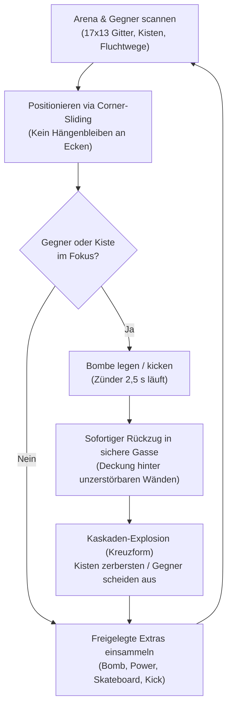

# 01 - High Concept & Core Gameplay Loop

## 1. High Concept
*ClanBomber: Godot Edition* ist ein rasantes 2.5D-Top-Down-Partyspiel für bis zu 8 lokale menschliche oder KI-gesteuerte Spieler, basierend auf dem GPL-Klassiker *ClanBomber*. 

Die Neuimplementierung verbindet das millimetergenaue, taktische Retro-Gameplay des Originals mit einer modernen **2.5D-Präsentation** in Godot 4:
- **Gameplay-Fundament:** Strenge, deterministische 2D-Simulationslogik auf einem festen 17×13 Kachelraster.
- **Visuelle Identität (2.5D):** Top-Down-Kamera mit leichter Neigung ($70^\circ$), dynamisches Punktlicht für brennende Lunten, physikalisch zersplitternde Kisten und volumetrische Glow-Explosionen im Godot 4 Forward+ Renderer.
- **Plattform:** Desktop (macOS, Linux, Windows), Local-First (Gamepads + Tastatur-Splits).

---

## 2. Die 4 Gameplay-Säulen
1. **Snappy & Präzise:** Flüssige, kontinuierliche Bewegung mit dynamischem **Corner-Sliding** (automatisches Hineingleiten in Gassen an Wandecken).
2. **Kettenreaktionen & Taktik:** Strategisches Legen, Kicken und Werfen von Bomben mit getakteten Kettenexplosionen ($0{,}1\,\text{s}$ Delay).
3. **Chaotischer Party-Multiplayer:** Bis zu 8 Spieler an einem Bildschirm (Gamepads, geteilte Tastaturen, schlaue KI-Bots).
4. **Vollständige Retro-Kompatibilität:** 100 % originalgetreue Unterstützung aller 33 kanonischen ClanBomber-Karten.

---

## 3. Core Gameplay Loop (5–10 Sekunden)

---

## 4. Win- & Loss-Bedingungen

### 4.1 Runden-Sieg
- **Letzter Überlebender:** Sobald maximal ein Spieler aktiv auf dem Feld steht und alle Detonationen abgeklungen sind, erhält dieser **+1 Siegpunkt**.
- **Unentschieden:** Sterben die letzten beiden Spieler in derselben Explosion, erhalten beide +1 Punkt.

### 4.2 Match-Sieg
- **First to 5:** Der erste Spieler mit **5 Siegpunkten** gewinnt das Match.
- Nach jedem Rundenende wird das Scoreboard eingeblendet und die nächste Karte geladen.

---

## 5. Scoring & Statistiken
- **Punkte:** +1 Match-Punkt pro gewonnene Runde.
- **Kills:** Zähler für direkt durch eigene Bomben eliminierte Gegner (Selbstmord zählt nicht als Kill).
- **Deaths:** Zähler für eigene Tode (durch Feindbomben oder Absturz im Sudden Death).
