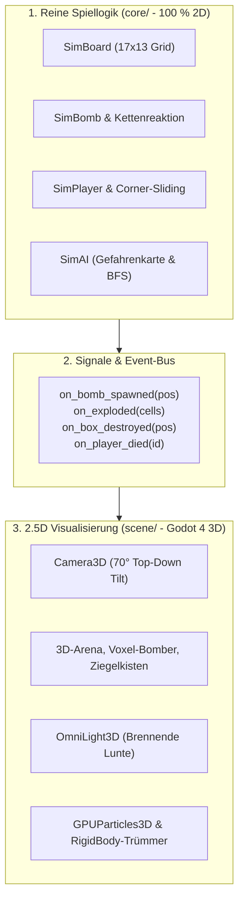

# 03 - Duale Architektur: 2D-Simulationskern vs. 2.5D-Präsentation

## 1. Das Dual-Architektur-Prinzip

Um maximale Performance, 100 % deterministische Testbarkeit und moderne 3D-Grafik zu vereinen, setzt *ClanBomber Godot* auf eine strikte Zweiteilung:



1. **Reine Simulation (`core/`):**
   - Erbt von `RefCounted` (keine Node-Abhängigkeiten).
   - Rechnet rein zweidimensional in Float- und Kachelkoordinaten $(x, y)$.
   - Kann headless im Terminal in **$< 50\,\text{ms}$** für Regressionstests durchlaufen werden.
2. **2.5D-Präsentation (`scene/`):**
   - Liest den Zustand aus dem Kern und transformiert $(x, y)$ in den 3D-Raum als $(x, 0, y)$.
   - Reagiert auf Events des Kerns für Effekte, Sound und Zerstörungsphysik.

---

## 2. Die 2.5D-Kamera & Verdeckungsvermeidung (Occlusion)

### 2.1 Kamera-Setup
- **Kameratyp:** `Camera3D` mit leichtem Top-Down-Neigungswinkel von **$70^\circ$ bis $75^\circ$**.
- **Projektion:** Orthogonal (`Projection: Orthogonal`) oder Perspektivisch mit kleinem FOV ($35^\circ$), um perspektivische Verzerrungen am Spielfeldrand zu minimieren.
- **Dynamic Camera Shake:** Feiner 3D-Kameraschüttler bei Kettenreaktionen und Detonationen.

### 2.2 Verdeckungsvermeidung (Visual Clarity)
In Bomberman ist die Übersicht über alle Kacheln überlebenswichtig:
- **Flache Wände:** 3D-Wandblöcke haben maximal eine halbe Kachelhöhe ($0{,}5$ Einheiten), sodass sie dahinterliegende Zellen nicht verdecken.
- **X-Ray / Dither Shader:** Befindet sich ein Spieler oder eine Bombe hinter einer Box oder Wand, schaltet ein Cutout-Shader die Wand semi-transparent oder stellt die Spielfigur als sichtbare Silhouette dar.

---

## 3. Beleuchtung, Shader & Partikel (Juiciness)

1. **Dynamisches Licht:**
   - Jede tickende Bombe besitzt ein kleines `OmniLight3D` an der Lunte, das mit ansteigender Zündfrequenz schneller pulsiert.
   - Detonationen erhellen die umliegenden Gänge für $0{,}5\,\text{s}$ mit hellem orangegelben Licht.
2. **Physikalische Kistenzerstörung:**
   - Bei der Detonation einer Kiste wird das statische Mesh durch 4–6 kleine `RigidBody3D`-Holztrümmer ersetzt, die durch einen physikalischen Radialimpuls nach außen geschleudert werden und nach 1 Sekunde ausfaden.
3. **Volumetrische Explosionen:**
   - Horizontale und vertikale Feuerwalzen aus glühenden `GPUParticles3D` mit Godot 4 Glow/Bloom-Post-Processing.

---

## 4. Projekt- und Ordnerstruktur

```text
clanbomber-godot/
├── core/                       # 100 % reine GDScript-Simulation (keine Nodes!)
│   ├── sim_board.gd            # 17x13 Gitter, Kachelzustände, Kollision
│   ├── sim_bomb.gd             # Zünder (2,5 s), Kettenreaktion (0,1 s), Kick
│   ├── sim_player.gd           # Kinematik, Corner-Sliding, Inventory
│   ├── sim_match.gd            # 90 s Timer, Rundenstatus, Sudden Death
│   └── sim_ai.gd               # Gefahren-Heatmap & BFS-Wegfindung
├── scene/                      # 2.5D Godot-Knotenschicht
│   ├── main.tscn               # Haupt-Szene mit Kamera, Licht und UI
│   ├── arena_view.tscn         # 3D-Mesh-Boden & Wände (GridMap / MeshInstance3D)
│   ├── bomber_view.tscn        # 3D-Charaktermodell mit Laufanimation
│   ├── bomb_view.tscn          # 3D-Bombe mit OmniLight3D-Lunte
│   └── explosion_view.tscn     # GPUParticles3D Feuerstrahl
├── resources/                  # Godot Custom Resources
│   ├── game_config.tres        # Zentrale Tuning-Parameter (Speeds, Dropraten)
│   └── map_resource.gd         # Datenstruktur für importierte .map-Dateien
├── assets/                     # 3D-Modelle, Texturen und Sounds
│   ├── models/                 # Low-Poly / Voxel-Meshes (glTF / GLB)
│   ├── sfx/                    # 27 Original-.wav Soundeffekte
│   └── music/                  # Retro-Soundtrack
└── test/                       # Automatisierte Headless-Tests
    ├── test_simulation.gd      # Bomben-Timer, Kicks, Kills, Selbstmord
    └── test_map_importer.gd    # Validierung aller 33 Original-Karten
```
