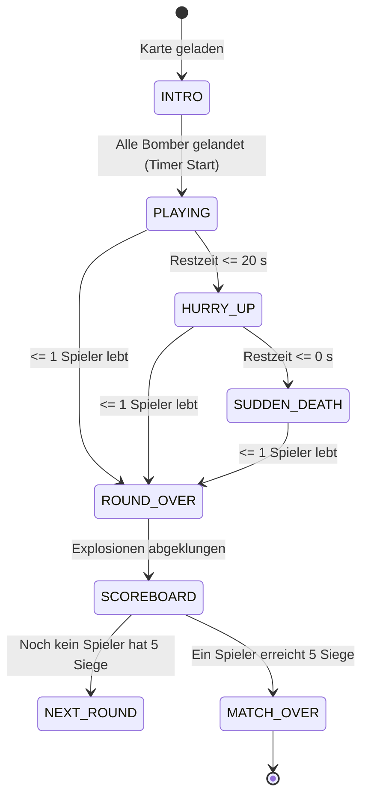

# 04 - Match-Flow & State Machine

## 1. Die Runden-Zustandsmaschine

Jede Runde in *ClanBomber Godot* durchläuft einen deterministischen Zustandsautomaten:

---

## 2. Die Zustände im Detail

### 2.1 INTRO (Einleitungsflug)
- **Ablauf:** Die Spielfiguren fliegen von der Bildschirmmitte mit einer Geschwindigkeit von **$200\,\text{px/s}$** auf ihre jeweiligen Startfelder.
- **Steuerung:** Deaktiviert.
- **Timer:** Steht fest auf $90{,}0\,\text{s}$ und startet erst, wenn alle Spieler auf ihren Feldern aufgesetzt haben.

### 2.2 PLAYING (Standard-Spielzeit)
- **Dauer:** Bis zu $90\,\text{s}$ Rundenzeit.
- **Aktionen:** Volle Kontrolle für Spieler und Bots; Kisten sprengen, Extras aufnehmen, Bomben kicken.

### 2.3 HURRY_UP (Warnphase)
- **Auslöser:** Restzeit fällt unter **$20\,\text{s}$** (im Original $21$ bis $18\,\text{s}$).
- **Feedback:** 
  - Warnsound (`hurry_up.wav`) ertönt.
  - Blinkender Text *"HURRY UP!"* im HUD.
  - Musikeffekte werden schneller oder intensiver.

### 2.4 SUDDEN_DEATH (Der Observer)
- **Auslöser:** Restzeit erreicht **$\le 0\,\text{s}$**.
- **Der Observer erwacht:** Ein mysteriöses Flugobjekt fliegt mit hoher Geschwindigkeit (**$500\,\text{px/s}$**) wiederholt auf zufällige Kacheln der Arena:
  1. Erster Anflug: Ansage *"TIME OVER!"*.
  2. Nachfolgende Anflüge: Die Kachel unter dem Observer verschwindet (`vanish`), stürzt in die Tiefe und hinterlässt ein Bodenloch (`Hole / -`).
  3. Befindet sich ein Spieler auf der Kachel, stürzt er in den Abgrund und scheidet aus (`fallen_down`).
  4. Liegen Extras auf der Kachel, weichen sie per Fluchtflug auf freie Felder aus.
- Die Arena schrumpft unerbittlich, bis die Entscheidung fällt.

### 2.5 ROUND_OVER & Abrechnung
- **Auslöser:** Maximal ein lebender Spieler ist noch auf den Beinen.
- **Wartebedingung:** Die Runde endet erst dann final, wenn:
  - keine aktive Explosion mehr brennt,
  - keine geworfenen Bomben oder Extras mehr durch die Luft fliegen,
  - und kein getroffener Spieler mehr in der Sterbe-Animation feststeckt.
- **Punktevergabe:** Der letzte Überlebende erhält **+1 Punkt**. Bei gleichzeitigem Tod erhalten beide verbliebenen Spieler +1 Punkt.

### 2.6 MATCH_OVER
- Erreicht ein Spieler **5 Punkte** (`points_to_win = 5`), gewinnt er das Match.
- Siegerehrung mit Sieger-Podest (`cup2.png` / 3D-Pokal) und Option auf Revanche.
